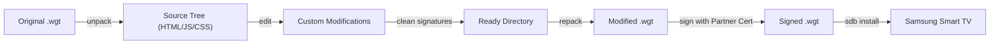

# Decompiling, Modifying & Repackaging Tizen TV Apps

## Anatomy of a `.wgt` Package
A Tizen `.wgt` (Web Widget) package is structurally an uncompressed or zip-compressed archive following the W3C Widget specification. Inside every package:

```
App.wgt (zip container)
├── config.xml             <-- Application manifest, permissions, and ID
├── index.html             <-- Application DOM entrypoint
├── css/                   <-- Stylesheets
├── js/                    <-- Application logic, state management, APIs
├── icon.png               <-- Smart Hub launcher icon (512x512)
├── author-signature.xml   <-- Developer signature (must be stripped when modifying)
└── signature1.xml         <-- Distributor/DUID signature (must be stripped when modifying)
```

---

## The Reverse Engineering & Modification Cycle



---

## Step 1: Unpack the Package
Use the helper script:
```bash
./scripts/wgt-unpack.sh ~/Downloads/samsung-tv-tools/Moonfin.wgt ./moonfin_src
```
Or manually:
```bash
mkdir -p moonfin_src
unzip -q Moonfin.wgt -d moonfin_src
```

---

## Step 2: Modifying Source Code & Assets

### 1. Hardcoding Server Endpoints
If a client defaults to an external cloud or you want to set your LAN media server as the default target, search for endpoint initializers:
```bash
grep -rn "http://" moonfin_src/
```
In JavaScript bundle files (e.g. `main.*.js` or `app.js`), locate host configuration functions and replace default URLs with your homelab reverse proxy or LAN address.

### 2. Custom CSS & Visual Styling
Inject custom styles by editing the stylesheet referenced in `index.html` or injecting a `<style>` block before `</head>`:
```html
<style>
  /* Custom subtitle styling for enhanced OLED/LED contrast */
  .subtitle-text {
    font-family: 'Samsung One', sans-serif !important;
    font-size: 1.4rem !important;
    text-shadow: 2px 2px 4px rgba(0, 0, 0, 0.9) !important;
  }
</style>
```

### 3. Granting Additional Tizen Privileges
If your modified code needs additional system or media APIs, add the privilege declaration into `config.xml`:
```xml
<!-- Example: Add TV Audio Volume Control Privilege -->
<tizen:privilege name="http://tizen.org/privilege/tv.audio"/>

<!-- Example: Allow All Origin Network Egress (CORS Bypass) -->
<access origin="*" subdomains="true"/>
```

---

## Step 3: Stripping Outdated Cryptographic Signatures
> [!IMPORTANT]
> If you modify even a single character in `index.html` or `config.xml`, the existing `author-signature.xml` and `signature1.xml` files will fail hash verification. You **must remove them** prior to repacking!

```bash
rm -f moonfin_src/author-signature.xml moonfin_src/signature1.xml
```

---

## Step 4: Repackaging the Application
Use the packaging helper script:
```bash
./scripts/wgt-pack.sh ./moonfin_src ./moonfin-modified.wgt
```

---

## Step 5: Signing and Sideloading
1. Sign the repackaged `.wgt` using your Samsung Partner certificate profile.
2. Sideload directly to the TV:
   ```bash
   ./scripts/tv-install.sh ./moonfin-modified.wgt
   ```
