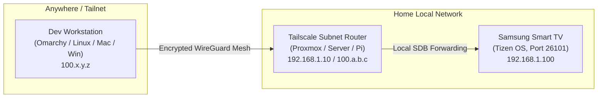

# Remote Sideloading & Tailscale Subnet Routing

## Why Tailscale in a Smart TV Homelab?
Samsung Smart TVs do not run native VPN clients (like Tailscale) reliably in the background. However, many homelabbers and developers manage devices across multiple subnets, isolated IoT VLANs, or even remotely outside the home.

By pairing Samsung's SDB bridge with a **Tailscale Subnet Router** on your home network, you unlock powerful remote deployment capabilities:
- Sideload or update apps on your living room TV from your workstation in the bedroom, office, or while traveling.
- Keep your Smart TV isolated on a restricted IoT VLAN (e.g., `192.168.10.0/24`) while seamlessly debugging it from your trusted LAN/Wi-Fi devices without complex firewall rules.

---

## Architecture Overview



---

## Setting Up Tailscale Subnet Routing for your TV

### Step 1: Advertise your TV Subnet
On an always-on Linux machine (like a home server, Proxmox LXC, or Raspberry Pi) inside your home network:
```bash
# Enable IP forwarding
echo 'net.ipv4.ip_forward = 1' | sudo tee -a /etc/sysctl.d/99-tailscale.conf
sudo sysctl -p /etc/sysctl.d/99-tailscale.conf

# Start Tailscale advertising the TV's local subnet (e.g. 192.168.10.0/24)
sudo tailscale up --advertise-routes=192.168.10.0/24
```

### Step 2: Approve the Route in Tailscale Admin Console
1. Navigate to the **Tailscale Admin Console** $\rightarrow$ **Machines**.
2. Find the Subnet Router machine $\rightarrow$ click the three dots $\rightarrow$ **Edit route settings**.
3. Toggle the advertised subnet route to **Approved**.

### Step 3: Connect to your TV Remotely
From your development workstation anywhere in the world:
```bash
# Ensure your workstation accepts routes
tailscale set --accept-routes=true

# Connect SDB directly to the TV's home LAN IP
./scripts/tv-connect.sh <TV_LAN_IP>
```

---

## ⚠️ The "Same-LAN" Conflict Gotcha (Must Read!)

If your development workstation is physically connected to the **same local Wi-Fi / LAN** as the TV, a routing conflict can occur:

### The Problem
When `--accept-routes=true` is enabled on your laptop, the Linux/Windows kernel routing table might route packets destined for your local subnet (e.g., `192.168.1.0/24`) into the `tailscale0` virtual adapter instead of directly out of your physical Wi-Fi interface (`wlan0` / `wlp9s0`). This causes `sdb connect` to time out on port `26101`.

### The Fix
When you are on the same local physical network as the TV, temporarily disable route acceptance on your machine:
```bash
tailscale set --accept-routes=false
```
Once your sideloading session is done, you can re-enable it if needed:
```bash
tailscale set --accept-routes=true
```
The included `scripts/tv-connect.sh` helper automatically detects this scenario and alerts you if route acceptance is active.
